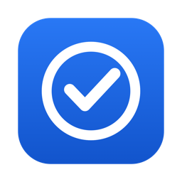
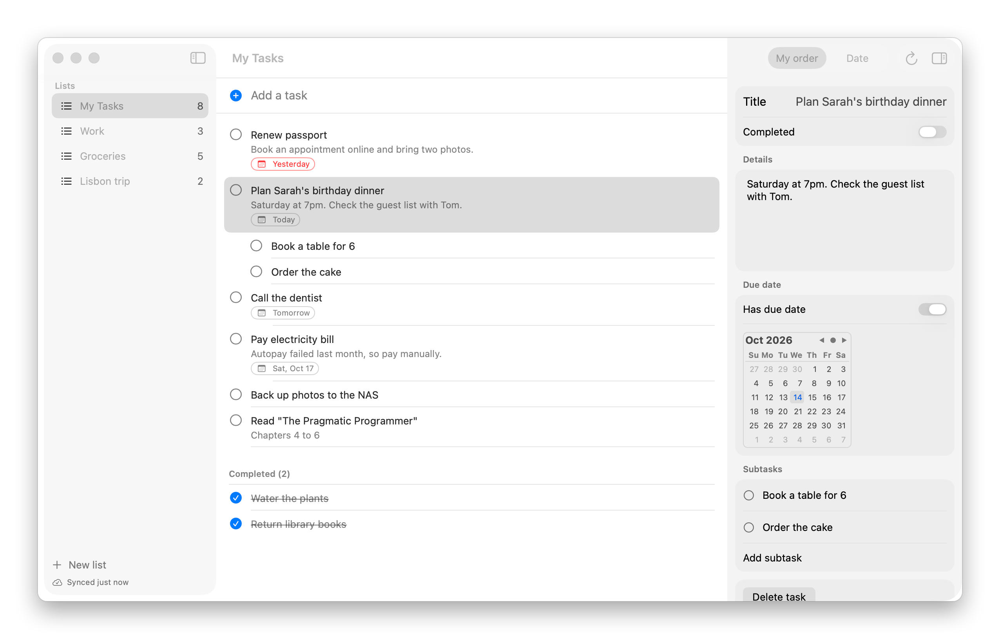
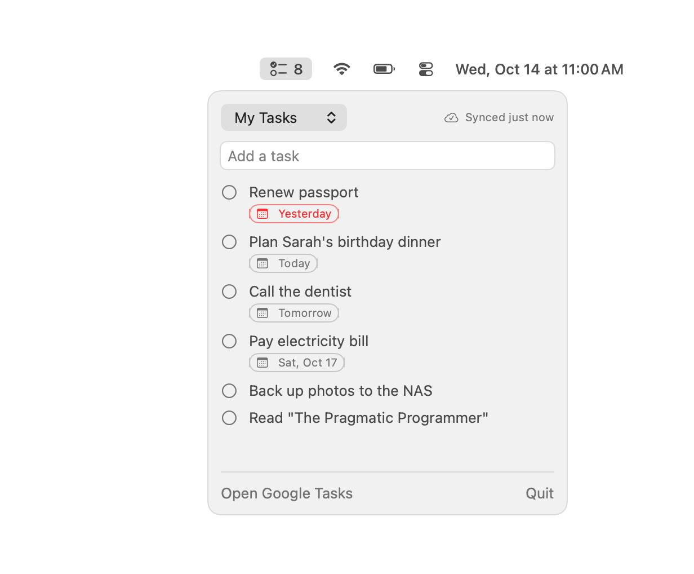
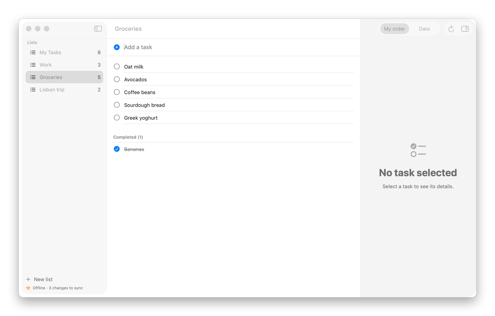
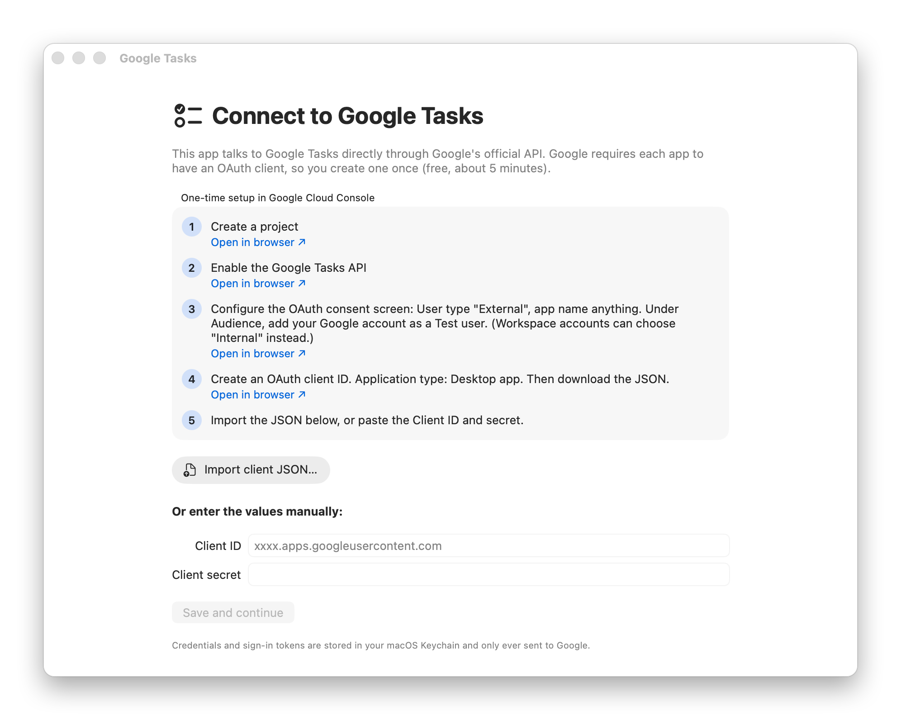

<div align="center">



# Google Tasks for Mac

**A fast, native macOS app for Google Tasks, with menu bar quick-add and offline support.**

Manage the same tasks you use on your phone and on tasks.google.com without opening a browser tab.


[](https://github.com/shahedex/Google-Tasks-Mac/releases/latest)
[](LICENSE)

<picture>
  <source media="(prefers-color-scheme: dark)" srcset="docs/screenshots/main-dark.png">
  
</picture>

</div>

## Features

- **Everything syncs with Google Tasks.** It uses Google's official API, so changes show up in the Android and iOS apps, Gmail, Calendar and tasks.google.com.
- **Lists.** Create, rename and delete task lists. Each list in the sidebar shows how many tasks are left.
- **Tasks.** Add a task by typing and pressing Enter. You can also tick tasks off, edit titles and notes, set due dates, add subtasks, move tasks between lists, and delete them.
- **Due dates at a glance.** *Today* and *Tomorrow* labels, and overdue tasks in red.
- **Two sort modes.** *My order* (the same order as your phone) or *Date*.
- **Menu bar app.** The menu bar icon shows how many tasks are left in the current list. Click it for a popup where you can add and tick off tasks. The app keeps running in the menu bar after you close the window.
- **Works offline.** Your tasks are saved on your Mac, so every change is instant. Changes made offline are queued and synced automatically when you're back online.
- **Quiet sync status.** A small label tells you whether you're *offline*, *syncing* or *synced*. No pop-ups.
- **Native and lightweight.** Built with SwiftUI, with light and dark mode and keyboard shortcuts (⌘R to sync, ⌫ to delete).

### Menu bar

The count updates as you complete tasks. Clicking the icon opens a popup where you can add tasks and tick them off without opening the main window.

<p align="center">
  <picture>
    <source media="(prefers-color-scheme: dark)" srcset="docs/screenshots/menubar-dark.png">
    
  </picture>
</p>

### Offline first

If you lose your connection, nothing freezes and nothing pops up. Keep working: changes are saved on your Mac, and the status label in the bottom-left corner shows how many are waiting. They sync automatically as soon as you're back online.

<p align="center">
  <picture>
    <source media="(prefers-color-scheme: dark)" srcset="docs/screenshots/offline-dark.png">
    
  </picture>
</p>

| Status | Meaning |
| --- | --- |
| `✓ Synced just now` | Everything matches Google. |
| `⟳ Syncing…` | Sending changes and downloading the latest data. |
| `↑ 2 changes to sync` | Online, and changes are about to be sent. |
| `⌁ Offline · 3 changes to sync` | No connection. Changes are saved and will sync later. |

Click the status label at any time to sync immediately.

## Getting started

### 1. Install the app

You need **macOS 14 (Sonoma) or later**. You can download a ready-made app, or build it yourself.

#### Option A: Download

1. Download **`Google-Tasks-Mac-v*.zip`** from the [latest release](https://github.com/shahedex/Google-Tasks-Mac/releases/latest). It runs on both Apple silicon and Intel Macs.
2. Unzip it and drag **Google Tasks.app** into **Applications**.
3. The app isn't notarized by Apple, so macOS blocks it the first time:
   - Double-click the app, then click **Done** on the warning.
   - Open **System Settings → Privacy & Security**, scroll down, and click **Open Anyway** next to "Google Tasks".
   - Or, in Terminal: `xattr -dr com.apple.quarantine "/Applications/Google Tasks.app"`

   You only need to do this once.

#### Option B: Build from source

You need the Swift toolchain. The Xcode Command Line Tools are enough; you don't need the full Xcode app.

```sh
xcode-select --install        # skip if you already have the Command Line Tools
git clone https://github.com/shahedex/Google-Tasks-Mac.git
cd Google-Tasks-Mac
./build.sh --install          # builds "Google Tasks.app" and copies it to /Applications
```

Run `./build.sh` without `--install` to build into `build/` only. Run `./build.sh --release` to make a universal zip like the one on the releases page. Builds are ad-hoc signed.

### 2. Create your own Google OAuth client (one time, about 5 minutes)

Google only lets apps read your tasks through an OAuth client. This project doesn't ship a shared client, so you create your own for free. Your data then goes straight between your Mac and Google, with nobody in between.

<p align="center">
  
</p>

The app's first screen links to each of these steps:

1. **Create a project** in the [Google Cloud Console](https://console.cloud.google.com/projectcreate).
2. **Enable the [Google Tasks API](https://console.cloud.google.com/apis/library/tasks.googleapis.com)** for that project.
3. **Set up the [OAuth consent screen](https://console.cloud.google.com/auth/overview):**
   - User type: **External**. Google Workspace users can choose *Internal* instead.
   - App name and support email: anything you like.
   - Under **Audience**, add your Google account as a **Test user**.
4. **[Create an OAuth client ID](https://console.cloud.google.com/auth/clients/create)** with the application type set to **Desktop app**, and download the JSON file.
5. In the app, click **Import client JSON…** and choose that file. You can also paste the Client ID and secret instead.

> [!TIP]
> While the consent screen is in **Testing** mode, Google expires sign-ins after 7 days. To stay signed in, open **Audience** and click **Publish app**. You don't need Google's verification for personal use; you'll just see an "unverified app" warning once when you sign in.

### 3. Sign in

Click **Sign in with Google**. Your browser opens once for Google's consent screen. Then return to the app and your lists load. After that you won't need the browser.

## How it works

```
┌──────────────┐  instant  ┌────────────────────┐   background sync   ┌───────────────────┐
│ SwiftUI views│ ────────► │ Local cache + queue│ ◄─────────────────► │ Google Tasks API  │
│ window + menu│ ◄──────── │ (Application Supp.)│   push queue, pull  │ tasks.googleapis  │
└──────────────┘           └────────────────────┘                     └───────────────────┘
```

- **Sign-in** uses OAuth 2.0 for installed apps: PKCE plus a one-time loopback redirect to `127.0.0.1`. The OAuth client and tokens are stored in the **macOS Keychain**.
- **Data**: the app keeps a copy of your lists and a queue of changes waiting to sync in `~/Library/Application Support/GoogleTasks/`. Every edit updates this local copy first, then goes into the queue. Both files are deleted when you sign out.
- **Sync** sends queued changes in order, then downloads the latest data and re-applies anything still waiting. It runs every 60 seconds, whenever you switch to the app, and as soon as the network comes back. While changes are waiting, it retries every 20 seconds. Tasks created offline get their real Google ID once they sync.

### Project layout

```
Sources/GoogleTasks/
├── App.swift                 App entry point, main window, menu bar extra, menus
├── AppModel.swift            Offline-first store and sync engine
├── SyncSupport.swift         Change queue, disk cache, network error handling
├── TasksAPI.swift            Google Tasks REST client and models
├── Auth.swift                OAuth (PKCE + loopback), Keychain
├── MainViews.swift           Sidebar, task list, task details panel
├── MenuBarView.swift         Menu bar popup
├── SyncStatusView.swift      Sync status label
├── SetupViews.swift          First-run setup and sign-in
└── ScreenshotRenderer.swift  Renders the README screenshots from demo data
```

## Limitations

These come from the public Google Tasks API:

- No **starred** tasks, and no **due times** or **repeating** tasks. Only due dates are available.
- If the same task is edited offline here and on another device, the change that syncs **last** is the one that stays.

## Development

```sh
swift build                    # debug build
./build.sh && open "build/Google Tasks.app"

# Regenerate the README screenshots (demo data; no account or network needed)
"build/Google Tasks.app/Contents/MacOS/GoogleTasks" --screenshots docs/screenshots

# Regenerate the app icon
swift scripts/make-icon.swift
```

## License

[MIT](LICENSE) © 2026 Shahed Mehbub. You're welcome to use, modify and share it.

---

<sub>Not affiliated with or endorsed by Google. Google Tasks is a trademark of Google LLC.</sub>
